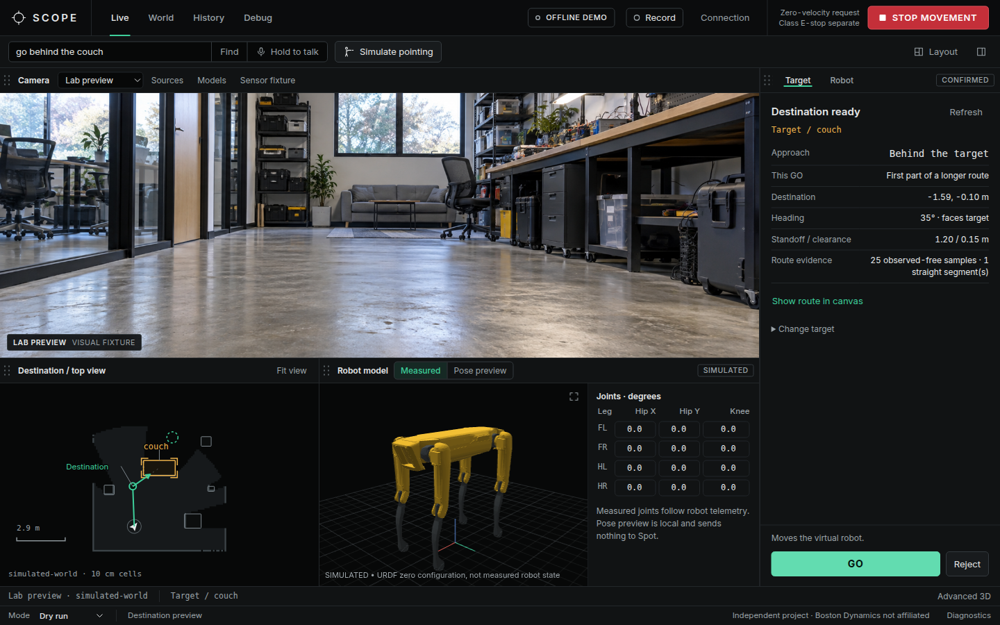
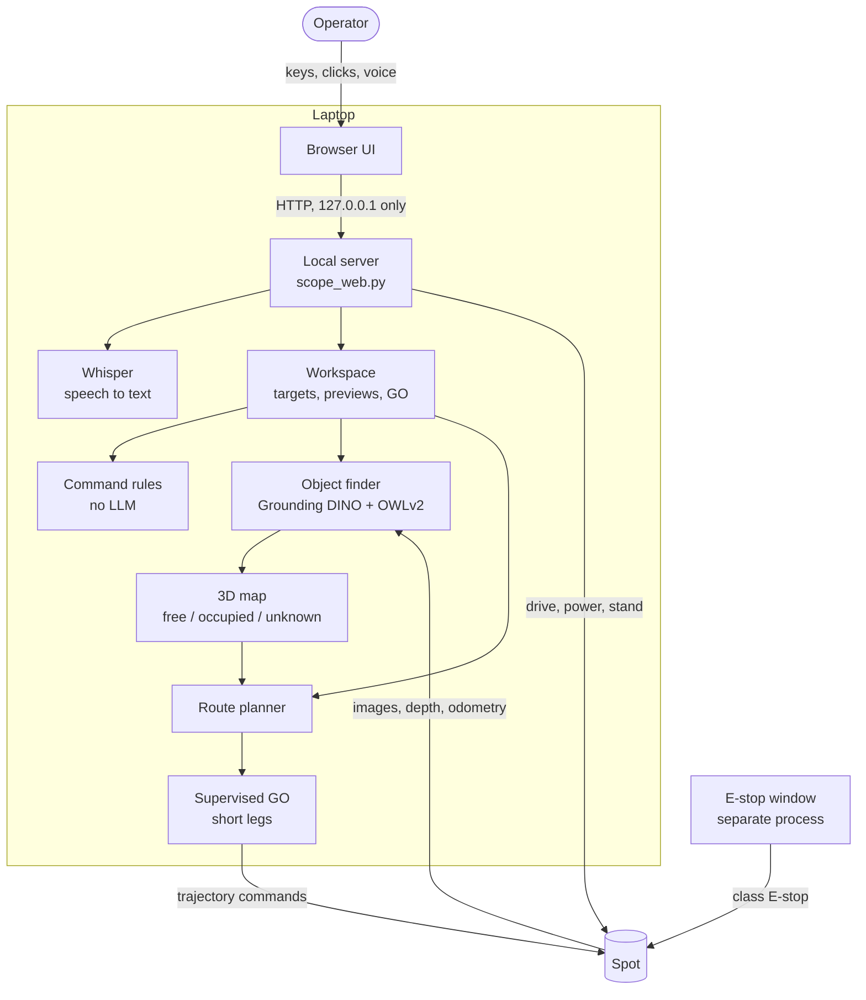
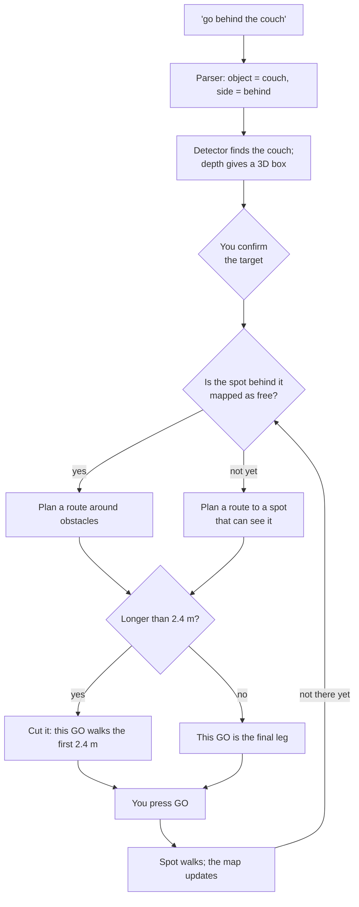
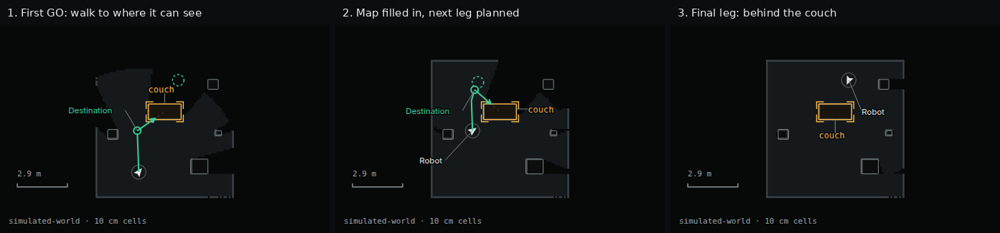

# SCOPE: a browser console for Boston Dynamics Spot

SCOPE (Spot Control, Observation, and Preview Environment) runs on a laptop next to the robot. It shows Spot's cameras, lets you drive it, and lets you send it somewhere by naming an object: type or say `go behind the couch`, check the planned route, then press GO. An offline demo with a simulated room runs the same flow without a robot.

This is an independent project, not a Boston Dynamics product, and nothing here is endorsed by them.



*Offline demo. The camera image is a generated fixture, not a Spot capture. The robot model shows the SDK model at its zero pose, not measured joint angles.*

## What it does

| | What you get | How far it has been checked |
| --- | --- | --- |
| **Drive** | W/A/S/D or on-screen buttons, 0.05 to 0.35 m/s, posture sliders | Unit tests with a fake robot |
| **Cameras** | All five fisheyes, a depth overlay, per-camera rate limits | Unit tests with fake image sources |
| **Find things** | Type any phrase ("red backpack") and an open-vocabulary detector finds it in the image; depth turns it into a 3D box on the map | Public indoor photos ([M4.5 report](docs/milestone-4.5.md)); not yet on Spot captures |
| **Go somewhere** | `go behind / left of / right of / next to / in front of <object>`, or point at it. Routes go around obstacles and are walked in short legs | Unit tests and the offline demo |
| **Voice** | Hold to talk; speech is transcribed on the laptop, so it works on Spot's Wi-Fi | Synthesized speech on the dev machine; no real microphone yet |
| **Record** | One click saves camera, depth, pose and map to a Rerun `.rrd` file | Offline demo |

Physical validation on Spot is still open; [the M5 checklist](docs/milestone-5.md) lists what has to pass first.

## How it fits together



The browser never talks to the robot directly. Everything goes through one local server bound to `127.0.0.1`, and one worker thread owns target selection and GO, so two tabs cannot race each other. The class E-stop is the SDK's own `estop_nogui.py` in its own terminal window. Closing SCOPE does not take it away.

## What happens when you say "go behind the couch"



Three things keep this predictable:

- **No language model decides where the robot goes.** Whisper writes down what you said. A small set of fixed rules ([`scope/commands.py`](scope/commands.py)) pulls out the object and the side. The vision models only find the object.
- **Routes only use space the cameras have seen.** Unknown space counts as a wall. A route has to clear Spot's footprint (0.42 m radius) plus 0.15 m everywhere along it.
- **Every leg needs its own GO.** After a leg, the console plans and previews the next one but never sends it by itself.



The dashed circle is the place you asked for. The green line is what the next GO will walk.

## Quick start

Python 3.11 to 3.14.

```sh
python3 -m venv .venv
.venv/bin/python -m pip install -r requirements-console.txt
.venv/bin/python scope_web.py --demo
```

This opens the console on `http://127.0.0.1` with the simulated room. Try `go behind the couch`, then **Confirm target**, then **GO**.

Object search and voice need the optional packages:

```sh
.venv/bin/python -m pip install "torch==2.14.1" "torchvision==0.29.1" "transformers>=4.57,<5" \
  "safetensors>=0.6" "psutil>=7" "h5py>=3.15" "faster-whisper>=1.1,<2"
```

Spot's Wi-Fi has no internet. Run one search and speak one command on a normal network first, so the models (about 1.5 GB) are downloaded. After that SCOPE loads them from disk.

The Spot SDK, model files, credentials and camera captures are not in this repository. The robot model panel and the E-stop launcher need a local SDK checkout in `spot-sdk/` (v5.2.0).

## On the robot

On a Mac, join Spot's Wi-Fi, have the tablet power off the motors and release control, and run `zsh "Start Spot.command"`.

1. The launcher checks this laptop and the robot. It asks for the password once and keeps it in the macOS Keychain.
2. That terminal becomes the **class E-stop**: space stops, `r` releases, `q` quits. Keep it in reach.
3. SCOPE opens in the browser. It connects in Robot control only after Spot reports that E-stop as active.
4. Press **Power On**, then **Stand**. Driving and GO unlock once fresh robot state says Spot is standing.

The safety rules that every movement path follows:

| Rule | Value |
| --- | --- |
| Manual drive command lifetime | 0.35 s; releasing a key sends zero velocity |
| GO speed and leg length | 0.2 m/s, at most 2.4 m of route per GO |
| GO command lifetime | 0.75 s, re-sent only after checking robot state and route again |
| Robot state too old | Movement locks; 10 s without state ends the connection |
| Stop, lost focus, hidden tab, error, shutdown | Zero velocity |

**STOP MOVEMENT** in the browser and a spoken "stop" both request zero velocity. Neither is the class E-stop.

On other systems, run the SDK's `estop_nogui.py` in one terminal and `.venv/bin/python scope_web.py` in another, then use **Connection**. The [console guide](docs/console-guide.md) covers every control, limit and check in detail.

## Repository layout

| Path | What is in it |
| --- | --- |
| `scope_web.py` | Local HTTP server, robot connection and manual control |
| `web/` | The browser console (plain HTML, CSS and JavaScript, no build step) |
| `scope/workspace.py` | Target selection, previews and GO for the browser |
| `scope/commands.py`, `scope/voice.py` | Command rules and local speech-to-text |
| `scope/live_interaction.py`, `scope/path_planning.py` | Destinations and routes |
| `scope/spot_navigation.py` | The supervised trajectory executor |
| `scope/spot_live_source.py`, `scope/mapping.py` | Spot cameras and the voxel map |
| `tests/` | 190 tests with fake robots, cameras and models |

## More tools

- [Console guide](docs/console-guide.md): every control, limit and check in the browser console.
- [How SCOPE works](docs/how-scope-works.html): an illustrated guide to the driving, mapping, object search, destination and GO logic, with the math behind each step. Open the file in a browser.
- [Desktop (Qt) console](docs/qt-console.md): the original manual console, with supervised gesture mode and the front panorama.
- [Offline mapping and perception](docs/offline-tools.md): RGB-D mapping, semantic objects, persistent memory, human pointing and text object queries, all runnable without a robot.
- [Unified console guide](docs/unified-console.md), the [M5 checklist](docs/milestone-5.md) and the [development history](docs/development-history.md).

To run the tests:

```sh
.venv/bin/python -m unittest discover
```

The suite has 190 tests, and 3 of them skip unless optional datasets are present.

## Future plans

Ideas only, none of this is in the app.

| Area | Direction |
| --- | --- |
| Wearable interfaces | Explore control or viewing through VR headsets or Meta Ray-Ban smart glasses. |
| Emotion-aware interaction | Investigate visual cues for human emotion recognition. |
| Recognition and personalities | Explore opt-in facial recognition and distinct interaction personalities for known people. |

## Contact

Ideas or questions: [monishsaravana@college.harvard.edu](mailto:monishsaravana@college.harvard.edu).

## Licensing

- SCOPE's own files use the [MIT License](LICENSE). It does not cover the SDK or third-party models.
- The Spot SDK is excluded. If you redistribute SDK files, Boston Dynamics' [SDK license](https://github.com/boston-dynamics/spot-sdk/blob/master/LICENSE) requires its full text and notices, and it restricts trademark use that implies endorsement.
- The MediaPipe gesture bundles are excluded until their redistribution terms are confirmed.
- The Grounding DINO Tiny, OWLv2 Base and SAM 2.1 Tiny model cards list Apache-2.0, and the bundles are still excluded. Revisions and links are in the [M4.5 report](docs/milestone-4.5.md).
