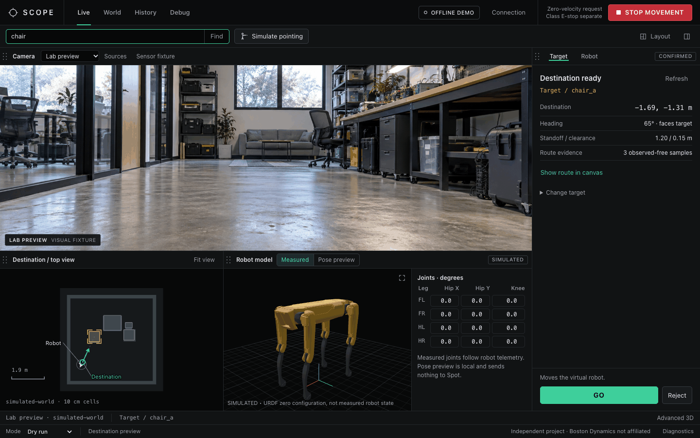
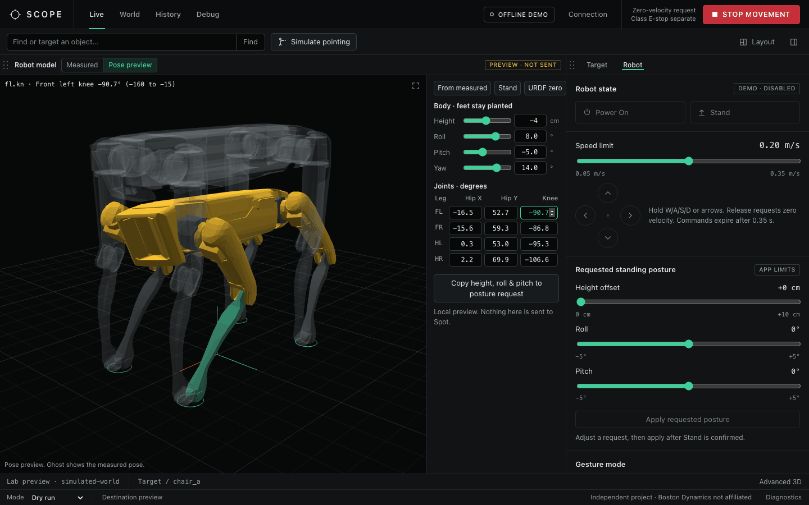

# Boston Dynamics Spot Control Console (SCOPE)

SCOPE (Spot Control, Observation, and Preview Environment) is a local browser console for a Spot robot. It shows the cameras, lets you drive manually, and lets you pick a target by text, pointing or a click on the map, with a destination preview before GO. An offline demo with a simulated room lets you try it without a robot.

This is an independent project, not a Boston Dynamics product, and nothing here is endorsed by them.



*Offline demo. The camera image is a generated fixture, not a Spot capture, and the robot model is the SDK model at its zero pose, not measured robot state.*

## Quick start

Python 3.11 to 3.14 is required.

```sh
python3 -m venv .venv
.venv/bin/python -m pip install -r requirements-console.txt
.venv/bin/python scope_web.py --demo
```

This opens a page on `http://127.0.0.1`. Useful options: `--port 8766`, `--no-browser`, and `--runs-dir PATH` (repeatable, default `./runs`) for the History page.

To connect to a robot, start without `--demo`, then use **Connection**:

```sh
.venv/bin/python scope_web.py
```

The form is prefilled with the class address and username. If the password is saved in the macOS Keychain (see below), leave it blank; otherwise it is used for that connection and not saved. The server listens on the loopback address only. Detection models run on the laptop and need no network once downloaded. Spot's Wi-Fi has no internet, so run one object search on a normal network first to download the detection models. After that SCOPE loads them from disk without network checks.

**macOS launcher.** Download the ZIP from GitHub, extract it, and run `zsh "Open SCOPE.command"`. It needs Git, Python 3.11 to 3.14 and an internet connection. It clones the repository to `~/Library/Application Support/SCOPE`, builds its own environment, and updates from `main` on each launch. The update logic was checked against a temporary Git repository; a fresh install from GitHub has not been run.

The Spot SDK, model bundles, credentials and camera captures are not in this repository. The robot model panel reads `spot-sdk/files/spot_base_urdf.zip` from a local SDK checkout and says so when it is missing.

## Using the console

| Page | What it is for |
| --- | --- |
| Live | Camera, world map, robot model and an inspector with **Target** and **Robot** tabs. |
| World | Occupancy map, entities and robot pose. **3D in Rerun** opens the advanced viewer. |
| History | The latest 500 maps, memory files, results and recordings under the `--runs-dir` folders. Read-only. `.rrd` files open in Rerun. |
| Debug | Copyable benchmark commands and module health. |

### Pick a target and preview a destination

1. Type `chair` in the search box. Other ways in: **Simulate pointing**, or **World**, select an entity, **Use as target**.
2. Pick a candidate and press **Confirm target**.
3. Check the destination, heading, standoff and route evidence in the inspector.
4. Press **GO**. Each preview works once and expires after 10 s, and evidence older than 1.5 s cannot be confirmed. In Robot control, manual drive, posture and gestures are blocked until the walk ends or you press Stop.

### Drive and posture (Robot control only)

| Control | Value |
| --- | --- |
| Speed limit | 0.05 to 0.35 m/s, starts at 0.20 m/s |
| Drive | Hold W/A/S/D, the arrow keys, or an on-screen direction button |
| Command expiry | 0.35 s without an update. The browser presence timeout is 0.30 s. |
| Height offset | 0 to +10 cm |
| Roll and pitch | ±5° each |

Driving unlocks only after fresh robot state confirms Spot is standing. Releasing a key requests zero velocity. Stop, focus loss, a hidden tab, a connection failure and shutdown all clear movement. The posture sliders set a request for **Apply**; they are not measured state, and Spot may not move by exactly the amount asked. The 0 to 10 cm and ±5° limits are conservative app limits, not verified safe ranges for this robot.

**STOP MOVEMENT** requests zero velocity and clears any approval. It is not the class E-stop.

### Perception models

**Models** on the Live camera panel picks the models used for object search. Each choice shows its measured speed and accuracy and what it means in practice.

| Setting | Choices |
| --- | --- |
| Object finder | Checked (Grounding DINO + OWLv2, the default) or Fast (Grounding DINO only) |
| Confidence needed | 0.35, 0.45 (default) or 0.55 |
| Image detail | 512 px (default) or 800/768 px |
| Object outline | GrabCut (default) or SAM 2.1 Tiny |
| Re-check the target every | 1.0, 1.5 (default) or 3.0 s |
| Run models on | Apple GPU when available (default) or CPU |

The quoted numbers come from public indoor photos and the development Mac, not from Spot's cameras ([M4.5 report](docs/milestone-4.5.md)). When connected, the dialog also shows search and outline times measured on that connection. Applying a change clears the current target, keeps the map, and loads the new models in the background. GO must be stopped before you change models. In the offline demo, searches return fixture results, so settings are only saved for the next Spot connection.

### Record a session

The live map and entities are kept in memory and are lost when you disconnect, unless you record. **Record** in the top bar saves the session to a new `live-<date>-<time>` folder under the first `--runs-dir`:

| File | Contents |
| --- | --- |
| `session.rrd` | Rerun recording at about 2 Hz: the processed camera image as shown on Live, depth points (every 6th pixel, up to 5 m), camera and robot pose, entity boxes, and the occupancy map every 10 s |
| `map.npz`, `map_config.json` | Final occupancy map, readable by `scope view` and the History page |
| `entities.json`, `manifest.json` | Final entity list, and the source pair, pose source, duration, sample count and stop reason |

**Finish recording** writes the final map and entities. Disconnecting, changing the camera pair and quitting with Ctrl-C also finish it. A recording stops itself at 1 GB, and the status turns into a warning from 80%. Samples are dropped, not queued, if the disk falls behind, and recording never delays Stop or GO. In the demo the pose and entities are simulated; on Spot the pose is measured odometry, entities are perception estimates, and depth points are only logged after alignment is confirmed. The robot address and login are not recorded. If SCOPE is killed rather than closed, `session.rrd` keeps what was written so far (Rerun opens it, `rerun rrd verify` reports a missing footer) and the final map files are missing.

The demo session (320×240 synthetic camera) records about 4 MB per minute. Spot's 640×480 cameras will be larger; that rate has not been measured.

The **Record** button shows its label and timer above 1320 px wide, only a dot below that, and is hidden below 900 px, like **Connection**.

### Robot model and layout

The **Robot model** panel draws the SDK model. In **Measured** mode it follows the 12 leg joint angles from fresh robot telemetry, but only when the robot's skeleton matches the SDK model. Body tilt is not measured, so the model is always drawn level. In the demo it shows the zero pose, labeled simulated.

**Pose preview** is local and sends nothing to Spot. Drag a leg or the body (Alt-drag for roll), or type joint angles and body height, roll, pitch and yaw. The feet stay planted with an approximate solver, and the Stand pose assumes a 0.52 m body height that was never measured. **Copy height, roll & pitch to posture request** fills the posture sliders, clamped to the limits above. Yaw stays in the preview.



Panels on Live and World can be rearranged: drag a panel bar onto another panel's edge to split it, onto its center to swap, or onto the workspace edge to dock. Drag the dividers to resize. **Layout** shows, hides and resets panels, and the arrangement is saved in the browser. Below 650 px wide the panels stack and cannot be dragged.

## Connecting to a real robot

Join Spot's Wi-Fi, make sure the tablet has powered off the motors and released control, then double-click **Start Spot.command** in the repository folder (or run `zsh "Start Spot.command"`).

- The first time, it asks for the robot password and saves it in the macOS Keychain under "SCOPE Spot". The password is not written to any file.
- That window becomes the class E-stop: space triggers it, `r` releases it, `q` quits. Keep it open.
- SCOPE starts in the background (log in `~/Library/Logs/SCOPE/scope.log`) and opens in the browser. It connects in Robot control only after Spot reports this E-stop as active.
- Press **Power On**, then **Stand**. Driving and GO stay locked until fresh robot state confirms Spot is standing still.
- Quitting the E-stop, or the E-stop failing to start, also closes SCOPE. `MotorsOnError` means the tablet still has the motors on.

Set `SPOT_HOST` or `SPOT_USER` to use a different robot or account. To change the saved password, run `security delete-generic-password -s "SCOPE Spot" -a user` and start the launcher again.

To do it by hand instead, run the SDK's `estop_nogui.py` in one Terminal and `.venv/bin/python scope_web.py` in another, then use **Connection**.

The console starts on `frontleft_fisheye_image` with `frontleft_depth_in_visual_frame` when the robot lists them. For Spot's registered depth (`<camera>_depth_in_visual_frame`), SCOPE checks alignment automatically: it compares depth jumps with image edges at the true position and at 6 to 10 px shifts, and needs three passing frames. This check was tuned on synthetic frames and has not been validated on Spot captures. If it cannot confirm the pair, the camera shows depth as a colored overlay (red near, blue far). Tick the alignment box in **Sources** only if the colors sit on the right objects. The map and GO stay off until alignment is confirmed.

Camera settings (**Sources** on the Live camera panel) control acquisition, display and rate for each source, from above 0 up to 30 Hz. The other fisheye cameras are shown at 2 Hz by default. One visual and depth pair feeds perception, and the depth list only offers the depth image registered to the chosen camera. Mapping and destination preview need confirmed alignment plus valid calibration, timestamps and odom transforms. Neither the automatic check nor the checkbox calibrates anything. The front panorama is an approximate stitch.

Returning to Observe or Dry run stops movement but keeps an existing command lease until you press **Disconnect**.

## More tools

- [How SCOPE works](docs/how-scope-works.html): an illustrated guide to the driving, mapping, object search, destination and GO logic, with the math behind each step. Open the file in a browser.
- [Desktop (Qt) console](docs/qt-console.md): the original manual console, with supervised gesture mode and the front panorama.
- [Offline mapping and perception](docs/offline-tools.md): RGB-D mapping, semantic objects, persistent memory, human pointing and text object queries, all runnable without a robot.
- [Unified console guide](docs/unified-console.md), the [M5 checklist](docs/milestone-5.md) and the [development history](docs/development-history.md).

To run the tests:

```sh
.venv/bin/python -m unittest discover
```

The suite has 164 tests, and 3 of them skip unless optional datasets are present.

## Future plans

Ideas only, none of this is in the app.

| Area | Direction |
| --- | --- |
| Voice input | Connect a microphone for spoken commands. |
| Wearable interfaces | Explore control or viewing through VR headsets or Meta Ray-Ban smart glasses. |
| Emotion-aware interaction | Investigate visual cues for human emotion recognition. |
| Recognition and personalities | Explore opt-in facial recognition and distinct interaction personalities for known people. |

## Contact

Ideas or questions: [monishsaravana@college.harvard.edu](mailto:monishsaravana@college.harvard.edu).

## Licensing

- SCOPE's own files use the [MIT License](LICENSE). It does not cover the SDK or third-party models.
- The Spot SDK is excluded. If you redistribute SDK files, Boston Dynamics' [SDK license](https://github.com/boston-dynamics/spot-sdk/blob/master/LICENSE) requires its full text and notices, and it restricts trademark use that implies endorsement.
- The MediaPipe gesture bundles are excluded until their redistribution terms are confirmed.
- The Grounding DINO Tiny, OWLv2 Base and SAM 2.1 Tiny model cards list Apache-2.0, and the bundles are still excluded. Revisions and links are in the [M4.5 report](docs/milestone-4.5.md).
