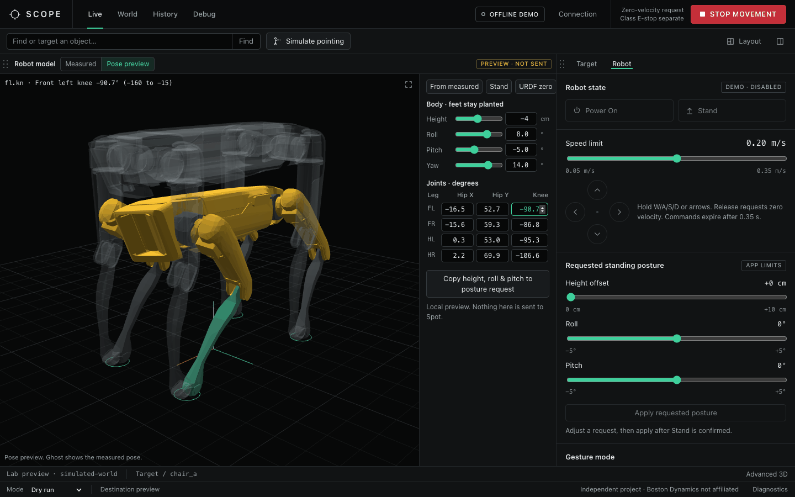

# SCOPE console guide

The full reference for the browser console: every control, limit and check. The [README](../README.md) has the short version.

## Using the console

| Page | What it is for |
| --- | --- |
| Live | Camera, world map, robot model and an inspector with **Target** and **Robot** tabs. |
| World | Occupancy map, entities and robot pose. **3D in Rerun** opens the advanced viewer. |
| History | The latest 500 maps, memory files, results and recordings under the `--runs-dir` folders. Read-only. `.rrd` files open in Rerun. |
| Debug | Copyable benchmark commands and module health. |

### Pick a target and preview a destination

1. Type `chair` (or a command such as `go behind the couch`, see below) in the search box. Other ways in: **Simulate pointing**, or **World**, select an entity, **Use as target**.
2. Pick a candidate and press **Confirm target**.
3. Check the destination, heading, standoff and route evidence in the inspector.
4. Press **GO**. Each preview works once and expires after 10 s, and evidence older than 1.5 s cannot be confirmed. In Robot control, manual drive, posture and gestures are blocked until the walk ends or you press Stop. On Spot the walk is limited to 2.5 m and 0.2 m/s, each trajectory command expires 0.75 s after it is sent, and the console checks the robot's state before every resend: standing to start, then standing, stepping or the transition between them while walking. A robot-state gap of up to 1 s while walking is waited out (the command has already expired, so Spot is standing still); a longer gap, a blocked route or a stop request ends the walk with zero velocity. Arrival is taken from the SDK's at-goal or near-goal feedback with a settled body, or from odometry alone once Spot has held the goal within 0.2 m and 0.25 rad for 1 s. The walk times out after 15 s or 10 s plus 10 s per metre, whichever is longer.

### Commands, routes and voice

The search box also takes short commands: `go behind the couch`, `go to the left of the table`, `go next to the chair`, `go in front of the sofa`, or `go behind that` (uses pointing for the object). Fixed rules, not a language model, turn a command into an object phrase and a side. The object phrase goes to the same detector search as before. Left and right are as seen from where the robot stood at the first preview, facing the object, and that reference is kept across legs so "behind" does not turn as Spot walks around. A bare phrase like `chair` keeps the old behaviour: stop 1.2 m in front of it.

Destinations are planned over the map with a route around obstacles. A route may only use cells observed free with Spot's footprint (0.42 m radius plus 0.15 m clearance) applied. Unknown cells count as blocked. The standoff drops to 0.9 m or 0.6 m when 1.2 m does not fit, for example near a wall. Each preview says what its GO does:

- **Final leg**: ends at the requested place, facing the object.
- **First part of a longer route**: one GO covers at most 2.4 m of route. It ends facing the object.
- **Look first**: the requested place is not mapped yet, which is normal behind an object seen from the front. This GO goes to a mapped viewpoint within 3 m of that place, with no observed obstacle or the object itself in the line of sight. It ends facing the unmapped place.

After a leg or a look arrives, the console waits for the map to update and previews the next leg for up to 12 s. It never sends it on its own: every leg needs its own GO, with the same freshness, standing and route checks as before. GO re-plans before it sends anything and refuses with `ROUTE CHANGED: preview again` if the new route strays more than 0.15 m from the one on screen, even when it ends in the same place. On Spot each bend of the route is commanded as its own trajectory point, because Spot walks each point in a straight line. The next bend is commanded once Spot is within 0.30 m of the current one, but only if the straight line from Spot's measured position to that bend also passes the clearance check; otherwise Spot finishes the current bend first.

**Voice.** Hold **Hold to talk** next to the search box and speak. Audio is transcribed on the laptop with [faster-whisper](https://github.com/SYSTRAN/faster-whisper) (`base.en`, int8 on CPU), so it works on Spot's Wi-Fi once the model is downloaded. Install it with `.venv/bin/python -m pip install "faster-whisper>=1.1,<2"`, then speak one command on a normal network to download the model (about 150 MB). The transcript is shown in the search box and runs the same path as typing. `yes`/`confirm`, `no`/`next`, `go` and `stop` press Confirm target, Reject, GO and STOP MOVEMENT, but only when that button is enabled. A spoken `stop` arrives about a second after you release the button; it is not a safety stop, and the class E-stop is still the one to rely on.

In the offline demo the room is 8 m square with a couch, a table, two chairs and a backpack. Only what the virtual robot has "seen" from its position is mapped: free cells along a 360° line of sight up to 6 m, so the space behind furniture stays unknown until the robot walks somewhere it can see it.

What has been checked: the parser, planner, leg splitting, look-first selection, corner-by-corner trajectory commands and the voice endpoint have unit tests with fake robots and a fake speech model. `go behind the couch` walks to the final leg in the demo, and faster-whisper transcribed synthesized speech of the example commands correctly on this laptop. None of it has run on Spot or with a real microphone in a robot room. Route planning depends on the live map being right, so check the map in **World** before each GO.

### Drive and posture (Robot control only)

| Control | Value |
| --- | --- |
| Speed limit | 0.05 to 0.35 m/s, starts at 0.20 m/s |
| Drive | Hold W/A/S/D, the arrow keys, or an on-screen direction button |
| Command expiry | 0.35 s without an update. Driving also stops after 0.30 s without a browser update and resumes when the updates continue. |
| Height offset | 0 to +10 cm |
| Roll and pitch | ±5° each |

Driving unlocks only after fresh robot state confirms Spot is standing. Releasing a key requests zero velocity. Stop, focus loss, a hidden tab, a connection failure and shutdown all clear movement. If robot state stops arriving or goes stale, movement locks and unlocks again on its own once fresh state shows Spot standing still; a gap longer than 10 s ends the connection. If the motors go off (the E-stop, the tablet or a fault), the console relocks and asks for **Power On** again. A Power On, Stand or Apply request that Spot rejects is reported in the status line without dropping the connection. The posture sliders set a request for **Apply**; they are not measured state, and Spot may not move by exactly the amount asked. The 0 to 10 cm and ±5° limits are conservative app limits, not verified safe ranges for this robot.

**STOP MOVEMENT** requests zero velocity and clears any approval. It is not the class E-stop.

### Perception models

**Models** on the Live camera panel picks the models used for object search. Each choice shows its measured speed and accuracy and what it means in practice.

| Setting | Choices |
| --- | --- |
| Object finder | Checked (Grounding DINO + OWLv2, the default) or Fast (Grounding DINO only) |
| Confidence needed | 0.35 (default), 0.45 or 0.55. The default is loose because Spot's grayscale fisheye images score lower than the photos the thresholds were tuned on; the checked finder still needs a second model to agree |
| Image detail | 512 px (default) or 800/768 px |
| Object outline | GrabCut (default) or SAM 2.1 Tiny |
| Re-check the target every | 1.0, 1.5 (default) or 3.0 s |
| Run models on | Apple GPU when available (default) or CPU |

The quoted numbers come from public indoor photos and the development Mac, not from Spot's cameras ([M4.5 report](milestone-4.5.md)). When connected, the dialog also shows search and outline times measured on that connection. Applying a change clears the current target, keeps the map, and loads the new models in the background. GO must be stopped before you change models. In the offline demo, searches return fixture results, so settings are only saved for the next Spot connection.

### Record a session

The live map and entities are kept in memory and are lost when you disconnect, unless you record. **Record** in the top bar saves the session to a new `live-<date>-<time>` folder under the first `--runs-dir`:

| File | Contents |
| --- | --- |
| `session.rrd` | Rerun recording at about 2 Hz: the processed camera image as shown on Live, depth points (every 6th pixel, up to 5 m), camera and robot pose, entity boxes, and the occupancy map every 10 s |
| `map.npz`, `map_config.json` | Final occupancy map, readable by `scope view` and the History page |
| `entities.json`, `manifest.json` | Final entity list, and the source pair, pose source, duration, sample count and stop reason |

**Finish recording** writes the final map and entities. Disconnecting, changing the camera pair and quitting with Ctrl-C also finish it. A recording stops itself at 1 GB, and the status turns into a warning from 80%. Samples are dropped, not queued, if the disk falls behind, and recording never delays Stop or GO. In the demo the pose and entities are simulated; on Spot the pose is measured odometry, entities are perception estimates, and depth points are only logged after alignment is confirmed. The robot address and login are not recorded. If SCOPE is killed rather than closed, `session.rrd` keeps what was written so far (Rerun opens it, `rerun rrd verify` reports a missing footer) and the final map files are missing.

The demo session (320×240 synthetic camera) records about 4 MB per minute. Spot's 640×480 cameras will be larger; that rate has not been measured.

The **Record** button shows its label and timer above 1320 px wide, only a dot below that, and is hidden below 900 px, like **Connection**.

### Robot model and layout

The **Robot model** panel draws the SDK model. In **Measured** mode it follows the 12 leg joint angles from fresh robot telemetry, but only when the robot's skeleton matches the SDK model. Body tilt is not measured, so the model is always drawn level. In the demo it shows the zero pose, labeled simulated.

**Pose preview** is local and sends nothing to Spot. Drag a leg or the body (Alt-drag for roll), or type joint angles and body height, roll, pitch and yaw. The feet stay planted with an approximate solver, and the Stand pose assumes a 0.52 m body height that was never measured. **Copy height, roll & pitch to posture request** fills the posture sliders, clamped to the limits above. Yaw stays in the preview.

Panels on Live and World can be rearranged: drag a panel bar onto another panel's edge to split it, onto its center to swap, or onto the workspace edge to dock. Drag the dividers to resize. **Layout** shows, hides and resets panels, and the arrangement is saved in the browser. Below 650 px wide the panels stack and cannot be dragged.

## Connecting to a real robot

Join Spot's Wi-Fi, make sure the tablet has powered off the motors and released control, then double-click **Start Spot.command** in the repository folder (or run `zsh "Start Spot.command"`).

- It first checks this laptop (the `.venv` environment, the SDK checkout, no second copy running) and that Spot answers at the robot address, and says what to fix if not.
- The first time, it asks for the robot password and saves it in the macOS Keychain under "SCOPE Spot". The password is not written to any file. The launcher hands it to SCOPE through that process's environment, so SCOPE does not need Keychain access of its own.
- That window becomes the class E-stop: space triggers it, `r` releases it, `q` quits. Keep it open.
- SCOPE starts in the background (log in `~/Library/Logs/SCOPE/scope.log`) and opens in the browser. The connection panel shows what it is waiting for. It connects in Robot control only after Spot reports this E-stop as active.
- If the tablet still holds control, SCOPE takes the lease and says so. The motors are already off at that point, because the E-stop setup requires it, and the tablet can take control back at any time.
- Press **Power On**, then **Stand**. Driving and GO stay locked until fresh robot state confirms Spot is standing still. If Power On is refused because the E-stop is engaged, press `r` in the E-stop window and try again; the connection stays up.
- Quitting the E-stop, or the E-stop failing to start, also closes SCOPE, which sends a final zero-velocity request and returns the lease. `MotorsOnError` means the tablet still has the motors on.

These connection paths were exercised with fakes in the test suite and in offline runs, not yet on a robot.

Set `SPOT_HOST` or `SPOT_USER` to use a different robot or account. To change the saved password, run `security delete-generic-password -s "SCOPE Spot" -a user` and start the launcher again.

To do it by hand instead, run the SDK's `estop_nogui.py` in one Terminal and `.venv/bin/python scope_web.py` in another, then use **Connection**.

The console starts on `frontleft_fisheye_image` with `frontleft_depth_in_visual_frame` when the robot lists them. For Spot's registered depth (`<camera>_depth_in_visual_frame`), SCOPE checks alignment automatically: it compares depth jumps with image edges at the true position and at 6 to 10 px shifts, and needs three passing frames. The check is advisory. Spot renders this depth into the camera's pixel grid itself, so if the check cannot confirm the pair within ten frames, or no usable pair arrives for 10 s, the map and GO go ahead with the pair as Spot delivers it and **Sources** reports the alignment as assumed. The camera keeps showing depth as a colored overlay (red near, blue far) until you tick the alignment box, and the check keeps running at a low rate and upgrades to confirmed when frames agree. The thresholds were tuned on synthetic frames and have not been validated on Spot captures; the overlay is the check that matters on the robot.

Camera settings (**Sources** on the Live camera panel) control acquisition, display and rate for each source, from above 0 up to 30 Hz. The other fisheye cameras are shown at 2 Hz by default. One visual and depth pair feeds perception, and the depth list only offers the depth image registered to the chosen camera. Mapping and destination preview need confirmed or assumed alignment plus valid calibration, timestamps and odom transforms. A pair is used only while both images were received within the last 1.0 s and were captured within 0.15 s of each other; otherwise the camera stays visible and the map pauses until fresh frames arrive. Spot renders the registered depth into the visual camera's pixel grid, so the pair is treated as one projection whichever camera model each source reports: if either reports fisheye (Kannala-Brandt) coefficients, both images are rectified with them; pinhole intrinsics the two sources both report must agree, otherwise the pair is refused. Neither the automatic check nor the checkbox calibrates anything. The front panorama is an approximate stitch.

Returning to Observe or Dry run stops movement but keeps an existing command lease until you press **Disconnect**.

